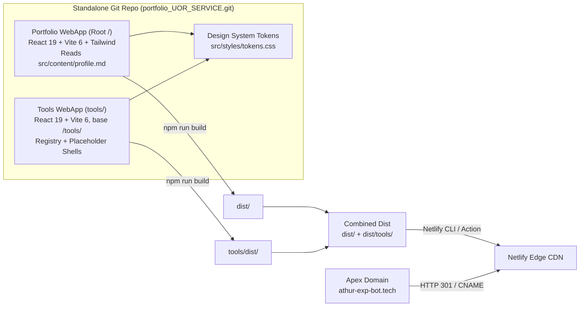

# [PRD] [MVP] AI SaaS Product Manager Portfolio & Tools Hub

**Author:** Athur Naufan Muharam (Product Manager)  
**Date:** October 23, 2026  
**Status:** Approved & Ready for Development (V3; integrates verified CV/Profile data and confirmed owner decisions)  
**Target Category:** `[1] Portfolio WebApp - Parent` (client workspace `+UOR-Service`)  
**Target Sprints:** Solo build, Phase 1 (1-2 weeks), Phase 2 (P2 Tools Expansion)  
**Parent Epic:** N/A (personal initiative, no Jira)  
**Target Platform:** Netlify (automated edge hosting & CDN) with redirect from domain `https://athur-exp-bot.tech/`  
**Git Remote:** `https://github.com/Athurnm/portfolio_UOR_SERVICE.git` (personal private repository)  
**Companion Artifacts:** [`design.md`](./design.md) | [`implementation-plan.md`](./implementation-plan.md) | [`Hyperplan_Review_2026-10-23.md`](./Hyperplan_Review_2026-10-23.md) | [`PRD_Review_Portfolio-WebApp_2026-10-23.md`](./PRD_Review_Portfolio-WebApp_2026-10-23.md)

---

## 1. Executive Summary & Problem Framing

### 1.1 Context & Core Blocker

The owner is a versatile Product Manager (~5 years) with an Information Systems background (ITB, GPA 3.75) and hands-on AI agent engineering capabilities, targeting senior AI Product Manager and Technical Product Manager roles in the Netherlands, Australia, and regional hubs. Today, career accomplishments across enterprise B2B SaaS (Matchmade), consumer travel marketplaces (PegiPegi), and tech-driven recruitment platforms (AdaKerja) exist primarily in static PDF CV and LinkedIn formats. Neither format demonstrates product thinking in motion, nor can they host interactive PM utilities, AI calculators, or live agentic prototypes under personal brand ownership.

Cost of inaction: In an increasingly saturated AI PM candidate market, resumes without live interactive proof-of-work are skimmed in under 2 minutes. This web application provides a high-performance, aesthetically refined personal portal combining:
1. **Curated Career & Case Studies Showcase**: High-impact metrics, AI product strategy, and technical competencies parsed directly from a decoupled `src/content/profile.md`.
2. **Modular Micro-Tools Hub (`/tools`)**: A scalable, decoupled playground (`tools/`) hosting PM utilities, AI economics calculators, and workflow prototypes with dedicated placeholder containers ready for Phase 2 expansion.

### 1.2 MVP Strategic Objective & Scope Boundary

| Scope | Item | Badge |
| :--- | :--- | :--- |
| **In scope (Phase 1)** | Portfolio site at `/` rendered from curated `src/content/profile.md` (Matchmade, PegiPegi, AdaKerja, CalSnap) | 🟢 NEW |
| **In scope (Phase 1)** | Global persistent navigation (pill on desktop, sliding sheet on mobile) with light/dark theme switch | 🟢 NEW |
| **In scope (Phase 1)** | Lazy-loaded, scroll-reactive Three.js "Amber Beacon" neural lattice with static SVG fallback | 🟢 NEW |
| **In scope (Phase 1)** | Separate **Tools app** in `tools/` (own `package.json`, built with base `/tools/`) containing Lab Standby & placeholder containers | 🟢 NEW |
| **In scope (Phase 1)** | Combined production artifact deployed to Netlify via Netlify CLI / GitHub Actions deploy | 🟢 NEW |
| **In scope (Phase 1)** | Netlify SPA routing rules (`_redirects`), security headers (`_headers`), WCAG 2.2 AA accessibility | 🟢 NEW |
| **Deferred (Phase 2)** | First live tool: Multilingual ASR Model Selector (seeded from `tools/drafts/Top Multilingual Transcription Models.md`) | 🟣 PHASE 2 (P2) |
| **Deferred (Phase 2)** | Interactive AI tools calling LLM APIs (via client-side bring-your-own-key or Cloudflare/serverless proxy) | 🟣 PHASE 2 (P2) |
| **Out of scope** | Backend database, user authentication/accounts, heavy CMS, blog comments engine | ❌ Rejected for MVP |

> ⚠️ **IMPORTANT**: Standalone prototype development must reside in its own Git repository (`https://github.com/Athurnm/portfolio_UOR_SERVICE.git`) and never be committed or staged into the parent Matchmade product-management workspace Git tree.

### 1.3 Success Metrics

Because this is a personal career asset rather than a corporate Matchmade initiative, metrics prioritize personal engagement and outreach conversion:

| Persona | Objective | Success Metric | Current Baseline | Target Goal (60 days post launch) | Measurement Source |
| :--- | :--- | :--- | :--- | :--- | :--- |
| **`VISITOR` (Founder / Recruiter)** | Drive high discovery volume | Total Page Views across `/` and `/tools` | 0 (no site) | >= 1,000 page views | GoatCounter / Netlify Analytics |
| **`VISITOR` (Hiring Team / Exec)** | Convert visit into direct communication | Email Contact Conversion Rate (`cta_contact_email_click` / unique visitors) | 0% | **Up to 30%** | GoatCounter custom event |
| **`VISITOR` (Peer / Engineer)** | Explore PM utilities lab | Tool Lab Engagement (`tools_nav_click` or blueprint clicks) | 0% | >= 15% of visitors | GoatCounter custom event |
| **`OWNER`** | Zero-friction profile updates | Time to publish updated case study or bio | N/A | <= 3 minutes via `git push` | GitHub Actions / Netlify Deploy |
| **`ENGINEERING`** | Elite performance & accessibility | Lighthouse Mobile Scores | N/A | Perf >= 85, A11y >= 95, SEO >= 95 | Lighthouse CI |

---

## 2. Integrated Career Profile & Case Studies Source of Truth

The portfolio content dynamically populates from `src/content/profile.md`, which is synthesized directly from the owner's verified background in `clients/+UOR-Service/profiles/cv-athur-ai-product-manager.md` and `clients/+UOR-Service/profiles/profile.md`:

### 2.1 Hero Profile & Executive Positioning

* **Name**: Athur Naufan Muharam
* **Role**: AI Product Manager / Technical Product Manager
* **Headline**: PM Who Builds -- 5 Years Product Leadership across B2B SaaS, Marketplace, & AI Agentic Systems
* **Target Geographic Markets**: Netherlands, Australia, Indonesia (Open to relocation, requires visa sponsorship)
* **Core Differentiator**: Bridges strategic product management (roadmaps, unit economics, stakeholder leadership) with hands-on technical execution (full-stack web development, local LLMs, autonomous agent workflows).

### 2.2 Hero KPI Badges (Verified with Sources)

| Metric Badge | Context / Initiative | Source Document Reference |
| :--- | :--- | :--- |
| **`IDR 1.2B/yr`** | Cost savings per enterprise client through automated financial reconciliation | `cv-athur-ai-product-manager.md:47` (Matchmade) |
| **`80% Faster`** | Reconciliation cycle reduced from 5 days to 1 day | `cv-athur-ai-product-manager.md:48` (Matchmade) |
| **`+60% CTR`** | Payment conversion rate uplift from optimized user checkout flows | `cv-athur-ai-product-manager.md:94` (AdaKerja) |
| **`3x Data Scale`** | Transaction volume scaled from 11 GB/month to 34 GB/month | `cv-athur-ai-product-manager.md:49` (Matchmade) |

### 2.3 Flagship Case Studies Specification

#### Case Study 1: Enterprise Data Reconciliation & AI Document Extraction (Matchmade Indonesia | 2024 -- Present)
* **Vertical**: Enterprise B2B SaaS
* **Problem**: Corporate accounting and operations teams spent 5 business days per cycle manually reconciling hundreds of thousands of ledger entries, banking statements, and invoices.
* **Product Strategy & Execution**:
  * Designed end-to-end automated reconciliation engine with customizable multi-table matching logic.
  * Architected and delivered operational dashboards and API integration points for enterprise clients.
  * Built an AI proof-of-concept using Docling for automated PDF-to-structured-table extraction, eliminating manual document re-keying.
* **Outcomes**: IDR 1.2 Billion annual savings per enterprise client, 80% cycle time reduction (5 days -> 1 day), data pipeline scale 3x (11 GB -> 34 GB/mo).

#### Case Study 2: B2C Travel Marketplace Optimization & Payment Infrastructure (PegiPegi | 2022 -- 2023)
* **Vertical**: B2C OTA (Accommodations, Flights, Transportation)
* **Problem**: High customer support overhead from failed transactions, 2 years of payment method stagnation, and inflated communication costs.
* **Product Strategy & Execution**:
  * Integrated modern payment channels unlocking new user cohorts; revamped checkout reducing payment friction.
  * Implemented automated duplicate account deduplication algorithms.
  * Integrated WhatsApp conversational notifications for transactional booking alerts; built internal CSO workflow acceleration tools.
* **Outcomes**: 85% reduction in refund processing time, 50% reduction in redundant accounts (saving 50% messaging quota), WhatsApp channel cut communication costs by 6% with 75% open rate, payment duration shortened by 40%, +10% new transacting users.

#### Case Study 3: Blue-Collar Recruitment Platform & Conversion Funnel (AdaKerja | 2021 -- 2022)
* **Vertical**: B2C Job Platform & SME Marketplace
* **Problem**: Low conversion in mobile payment funnels and fragmented product development during corporate restructuring.
* **Product Strategy & Execution**:
  * Formulated and executed unified product roadmap aligning 3 engineering squads with business leadership.
  * Redesigned applicant submission flows and optimized payment conversion funnels.
* **Outcomes**: Increased payment click-through rate (CTR) by ~60%; laid architectural groundwork for scalable mobile candidate matching.

#### Case Study 4: AI & Autonomous Agent Projects
* **CalSnap (`calendar-snap.vercel.app`)**: AI-powered calendar event parser vibe-coded with Antigravity IDE, Supabase, and Vercel. Extracts event metadata from unstructured image screenshots and text snippets, exporting seamlessly to Google Calendar and `.ics`.
* **Wedding Evite (`athur-hidup-dengan-dara.info`)**: Mobile-responsive single-page application built on React, Supabase, and Vercel.
* **Autonomous Agent Workflows**: Self-architected personal and operational agents built with n8n, OpenClaw, and Antigravity for automated document triage and PM task orchestration.

### 2.4 Education & Technical Stack

* **Education**: Bachelor of Information Systems (S.Kom), Institut Teknologi Bandung (ITB) -- GPA: 3.75 / 4.00 (Thesis: AI implementation in anomaly fraud detection).
* **AI & Agentic Automation**: n8n, OpenClaw, Antigravity IDE, Prompt Engineering, RAG architectures, local LLMs, Docling.
* **Full-Stack Development**: JavaScript, TypeScript, Node.js, React, Next.js, Vite, Tailwind CSS, Supabase, Vercel, Netlify.
* **Product Leadership**: Product roadmapping, user research, data modeling, Gherkin specifications, A/B testing, enterprise stakeholder management.

---

## 3. System Architecture & Technical Contracts

### 3.1 Architecture Overview

The web application adopts a two-tier decoupled Single Page Application (SPA) architecture built in JavaScript:



### 3.2 Technical Routing & SPA Contract

| Route | Responsible App | Behavior | Fallback / Status |
| :--- | :--- | :--- | :--- |
| `/` | Portfolio SPA | Renders dynamic Markdown portfolio, Hero, Case Studies, Experience | `200 OK` |
| `/tools/` | Tools SPA | Renders Lab Standby gallery + blueprint tool cards | `200 OK` |
| `/tools/:slug` | Tools SPA | Renders placeholder container page for registered blueprint tool | `200 OK` |
| `/tools/unknown` | Tools SPA | Renders Tools 404 page with `[Back to Tools]` CTA | `200 OK` + `noindex` |
| `/unknown-path` | Portfolio SPA | Renders Portfolio 404 page with `[Back to Portfolio]` CTA | `200 OK` + `noindex` |
| `/cv.pdf` | Static Asset | Direct PDF download of latest curated resume | `200 OK` |

> ⚠️ **IMPORTANT**: Cross-navigation between `/` and `/tools/` uses native HTML anchor links (`<a href="/tools/">` and `<a href="/">`), triggering clean full-page loads. Both apps share identical navigation pills, themes, and font tokens to make transitions seamless.

### 3.3 Netlify Configuration Contracts

#### Netlify Redirect Rules: `public/_redirects`
```text
# Tools sub-application SPA routing
/tools/*    /tools/index.html   200

# Root portfolio SPA routing
/*          /index.html         200
```

#### Netlify Security & Header Contract: `public/_headers`
```text
/*
  X-Content-Type-Options: nosniff
  X-Frame-Options: SAMEORIGIN
  Referrer-Policy: strict-origin-when-cross-origin
  Permissions-Policy: geolocation=(), microphone=(), camera=()
  Content-Security-Policy: default-src 'self'; script-src 'self' 'unsafe-inline' https://gc.zgo.at; connect-src 'self' https://*.goatcounter.com; img-src 'self' data:; style-src 'self' 'unsafe-inline'; font-src 'self'; frame-ancestors 'self'; base-uri 'self'; form-action 'self'

/*.html
  Cache-Control: no-cache, no-store, must-revalidate

/assets/*
  Cache-Control: public, max-age=31536000, immutable
```

---

## 4. Core User Stories & Acceptance Criteria

#### **[US-001] Curated Career & Case Studies Portfolio View**
* **Sprint:** Phase 1
* **Surfaces:** `/`
* **Priority:** `P0`
* **User Story:** As an executive recruiter or AI SaaS founder, I want to review Athur's background, verified metrics, and case studies so that I can validate technical product leadership in under 2 minutes.
* **Scenario:** Rendering profile from frontmatter and markdown
  * **Given** `src/content/profile.md` contains valid metadata and Markdown case studies
  * **When** a visitor navigates to `/`
  * **Then** the hero displays name, headline, location, and the 4 verified KPI badges (`IDR 1.2B/yr`, `80% Faster`, `+60% CTR`, `3x Data Scale`)
  * **And** the 3 flagship case studies (Matchmade, PegiPegi, AdaKerja) and CalSnap project render in structured, responsive cards
  * **And** contact options (Email, LinkedIn, GitHub, Medium) are accessible in the header and footer.

#### **[US-002] Responsive Navigation & Amber Theme Switcher**
* **Priority:** `P0`
* **User Story:** As a visitor, I want a persistent, accessible navigation bar with light/dark console modes so that I can explore the site comfortably on any screen.
* **Scenario:** Desktop floating pill
  * **Given** viewport width >= 768px
  * **When** the page renders
  * **Then** a floating pill navbar (64px high, 16px from top) displays the pulsing Amber Beacon indicator, brand title, links to `Portfolio` and `Tools` (labeled `Lab`), a theme toggle, and a `Contact` button.
* **Scenario:** Mobile menu sheet
  * **Given** viewport width < 768px
  * **When** the visitor taps the menu button
  * **Then** an accessible sliding sheet opens, focus is trapped within the sheet, and tapping `Esc` or backdrop dismisses it.
* **Scenario:** Theme persistence
  * **Given** a visitor switches to Dark Console mode
  * **When** the page is refreshed or user navigates to `/tools/`
  * **Then** `data-theme="dark"` is preserved seamlessly without visual flickering.

#### **[US-003] Scroll-Reactive 3D Amber Beacon with Accessibility Fallback**
* **Priority:** `P1`
* **User Story:** As a visitor, I want a modern visual experience that signals AI engineering fluency without slowing down my device.
* **Scenario:** WebGL and animation capable device
  * **Given** device supports WebGL, `prefers-reduced-motion` is false, and `saveData` is false
  * **When** browser is idle after initial page paint
  * **Then** the procedural Three.js Amber Beacon lattice loads asynchronously and smoothly responds to scroll depth.
* **Scenario:** Low-spec device or reduced motion
  * **Given** `prefers-reduced-motion: reduce` or lack of WebGL
  * **When** page loads
  * **Then** the 3D bundle is omitted from the network request and an optimized SVG beacon poster displays statically.

#### **[US-004] Micro-Tools Hub & Lab Standby Page (`/tools`)**
* **Priority:** `P0`
* **User Story:** As a peer product manager or engineer, I want to explore upcoming AI PM micro-tools so that I can preview interactive utilities in development.
* **Scenario:** Lab Standby view
  * **Given** tools are in blueprint status
  * **When** a visitor visits `/tools/`
  * **Then** the page renders the Amber Beacon Lab Standby card (`STATUS: STANDBY // PIPELINE INITIALIZED`)
  * **And** renders 3 blueprint cards: *LLM Token Economics Simulator*, *PRD Prompt Compiler*, and *Multilingual ASR Model Selector*
  * **And** clicking any card navigates to `/tools/:slug`.

#### **[US-005] Reusable Tool Container Page (`/tools/:slug`)**
* **Priority:** `P0`
* **User Story:** As the site owner, I want a standardized container page for every micro-tool so that Phase 2 utilities can be published without modifying navigation or layout chrome.
* **Scenario:** Blueprint tool container
  * **Given** a visitor navigates to `/tools/llm-token-economics`
  * **When** the page loads
  * **Then** the container displays breadcrumbs (`Tools / LLM Token Economics`), title, category badge, `In Development` status chip, and a sandboxed workspace container
  * **And** includes a `[Back to Tools]` action button.

#### **[US-006] Direct Contact & Outreach Conversion**
* **Priority:** `P0`
* **User Story:** As an interested hiring manager, I want an immediate way to initiate contact via email so that I can reach out directly.
* **Scenario:** Contact trigger
  * **When** the visitor clicks `Contact` or `athurnm@gmail.com`
  * **Then** an email client link opens with prefilled subject (`[Inquiry] AI Product Manager - Opportunity`), and a GoatCounter conversion event is logged.

---

## 5. Non-Functional Requirements (NFRs)

| ID | Category | Requirement | Target Metric | Verification |
| :--- | :--- | :--- | :--- | :--- |
| NFR-01 | Performance | Initial JS bundle (Portfolio, excluding 3D chunk) | <= 120 KB gzipped | Vite build analyzer |
| NFR-02 | Performance | Lazy Three.js Beacon chunk | <= 280 KB gzipped, loaded on idle | Bundle size budget in CI |
| NFR-03 | Performance | Lighthouse Mobile Performance Score | >= 85 (Mobile), >= 92 (Desktop) | Lighthouse audit |
| NFR-04 | Accessibility | WCAG 2.2 AA Contrast Compliance | All body text >= 4.5:1 (using `--amber-text`), borders >= 3:1 | axe-core automated audit |
| NFR-05 | Responsiveness | Fluid layout scaling across viewports | Zero horizontal overflow from 320px to 2560px | Responsive testing matrix |
| NFR-06 | Security | Content Security Policy & HTTP Headers | No inline script eval, Mozilla Observatory >= A | Netlify headers check |
| NFR-07 | Scalability | Modular tool addition in `tools/src/tools/` | 0 modifications to root portfolio shell | Independent PR review |
| NFR-08 | SEO | OpenGraph metadata and static crawler tags | Unique title, description, and preview image | Social share debugger |

---

## 6. Telemetry & Conversion Event Registry (GoatCounter)

Telemetry uses privacy-friendly, cookieless GoatCounter custom events:

| Event Path | Trigger Condition | Attribute Payload | Maps to Objective |
| :--- | :--- | :--- | :--- |
| `pageview` | Initial page load on any route | URL path | Total discovery page views |
| `cta_contact_email_click` | Visitor clicks email address or Contact CTA | `mailto:athurnm@gmail.com` | Primary conversion rate (Target <= 30%) |
| `cta_linkedin_click` | Visitor clicks LinkedIn profile link | `https://linkedin.com/in/athurnm` | Secondary professional outreach |
| `cta_github_click` | Visitor clicks GitHub profile link | `https://github.com/athurnm` | Technical proof-of-work engagement |
| `tools_nav_click` | Visitor navigates from Portfolio to Tools | Source element (`navbar`, `hero_btn`) | Tool Lab engagement rate |
| `tool_blueprint_click` | Visitor clicks a blueprint card in `/tools/` | Tool slug (`llm-token-economics`, etc.) | Phase 2 utility demand ranking |
| `theme_toggle_click` | Visitor switches light/dark mode | `light` vs `dark` | Aesthetic usability telemetry |

---

## 7. Decision Log

The following decisions are formally recorded in `journal/state/decisions.json` with the `NON-MM` suffix to maintain separation from Matchmade company initiatives:

| ID | Date | Decision Summary | Rationale | Status |
| :--- | :--- | :--- | :--- | :--- |
| **`DEC-0235-NON-MM`** | 2026-10-23 | Decoupled two-tier architecture: Root Portfolio SPA (`/`) + Independent Tools SPA (`/tools/`) | Isolates experimental tool scripts from the main portfolio shell and guarantees zero crash cross-contamination. | `decided` |
| **`DEC-0236-NON-MM`** | 2026-10-23 | Tech Stack: JavaScript ESNext, React 19, Vite 6, Tailwind CSS v4, Three.js Beacon | Maximizes build speed, compatibility, and adheres to owner language preference. | `decided` |
| **`DEC-0237-NON-MM`** | 2026-10-23 | Netlify edge deployment with redirect from `https://athur-exp-bot.tech/` | Replaces Hostinger shared hosting; leverages Netlify automated SPA routing and edge CDN. | `decided` |
| **`DEC-0238-NON-MM`** | 2026-10-23 | Dedicated Git repository connected to `https://github.com/Athurnm/portfolio_UOR_SERVICE.git` | Enforces personal private repository boundary rule without polluting parent workspace Git. | `decided` |
| **`DEC-0239-NON-MM`** | 2026-10-23 | SSOT career data integration from `profile.md` and `cv-athur-ai-product-manager.md` | Populates verified high-impact metrics (IDR 1.2B savings, +60% CTR, 3x data scale) and AI credentials. | `decided` |
| **`DEC-0240-NON-MM`** | 2026-10-23 | Personal conversion metrics: Total Page Views & up to 30% email conversion rate within 2 months | Replaces corporate B2B metrics with actionable personal career milestones. | `decided` |
| **`DEC-0241-NON-MM`** | 2026-10-23 | Amber Beacon design tokens with accessible `--amber-text` token separation | Enforces WCAG 2.2 AA contrast compliance while preserving glowing amber aesthetic. | `decided` |

---

## 8. Owner Confirmations & Execution Clearance

All initial planning inquiries have been resolved:
1. **Language**: Confirmed **JavaScript** (ESNext, React 19, Vite 6).
2. **Domain & Hosting**: Confirmed **Netlify** edge hosting with redirect from apex domain `https://athur-exp-bot.tech/`.
3. **Repository Remote**: Confirmed personal private GitHub repository `https://github.com/Athurnm/portfolio_UOR_SERVICE.git`.
4. **Primary Conversion Target**: Confirmed total page views and up to 30% email conversion rate.
5. **Content Clearance**: Confirmed existing CV and profile details are sufficiently redacted and approved for public display.
6. **Execution Directive**: Confirmed clearance to initialize repository and begin development.
