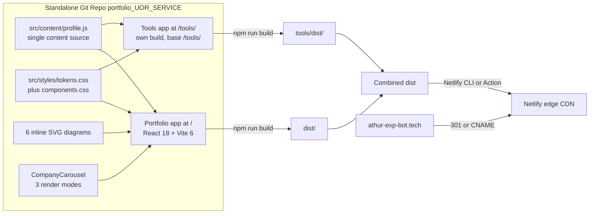

# [PRD] [MVP] AI SaaS Product Manager Portfolio & Tools Hub

**Author:** Athur Naufan Muharam (Product Manager)  
**Date:** October 24, 2026  
**Status:** Built, audited, and revised (V4; describes the shipped build after anti-slop audit #002)  
**Target Category:** `[1] Portfolio WebApp - Parent` (client workspace `+UOR-Service`)  
**Target Sprints:** Solo build, Phase 1 (1-2 weeks), Phase 2 (P2 Tools Expansion)  
**Parent Epic:** N/A (personal initiative, no Jira)  
**Target Platform:** Netlify (automated edge hosting & CDN) with redirect from domain `https://athur-exp-bot.tech/`  
**Git Remote:** `https://github.com/Athurnm/portfolio_UOR_SERVICE.git` (personal private repository)  
**Companion Artifacts:** [`DESIGN.md`](./DESIGN.md) (brand direction and tokens) | [`design-system.md`](./design-system.md) (3D and component specs) | [`implementation-plan.md`](./implementation-plan.md) | [`Hyperplan_Review_2026-10-23.md`](./Hyperplan_Review_2026-10-23.md) | [`PRD_Review_Portfolio-WebApp_2026-10-23.md`](./PRD_Review_Portfolio-WebApp_2026-10-23.md)

---

## 1. Executive Summary & Problem Framing

### 1.1 Context & Core Blocker

The owner is a versatile Product Manager (~5 years) with an Information Systems background (ITB, GPA 3.75) and hands-on AI agent engineering capabilities, targeting senior AI Product Manager and Technical Product Manager roles in the Netherlands, Australia, and regional hubs. Today, career accomplishments across enterprise B2B SaaS (Matchmade), consumer travel marketplaces (PegiPegi), and tech-driven recruitment platforms (AdaKerja) exist primarily in static PDF CV and LinkedIn formats. Neither format demonstrates product thinking in motion, nor can they host interactive PM utilities, AI calculators, or live agentic prototypes under personal brand ownership.

Cost of inaction: In an increasingly saturated AI PM candidate market, resumes without live interactive proof-of-work are skimmed in under 2 minutes. This web application provides a high-performance, aesthetically refined personal portal combining:
1. **Curated Career & Case Studies Showcase**: High-impact metrics, AI product strategy, and technical competencies read from a decoupled `src/content/profile.js`.
2. **Modular Micro-Tools Hub (`/tools`)**: A scalable, decoupled playground (`tools/`) hosting PM utilities, AI economics calculators, and workflow prototypes with dedicated placeholder containers ready for Phase 2 expansion.

### 1.2 MVP Strategic Objective & Scope Boundary

| Scope | Item | Badge |
| :--- | :--- | :--- |
| **In scope (Phase 1)** | Portfolio site at `/` rendered from `src/content/profile.js` (Matchmade, PegiPegi, AdaKerja, CalSnap) | 🟢 SHIPPED |
| **In scope (Phase 1)** | Seven sections, each with its own composition: hero, impact band, career arc, selected work, capability, tools lab, contact | 🟢 SHIPPED |
| **In scope (Phase 1)** | Pinned, scroll-driven company carousel with one case study per screen and three render modes | 🟢 SHIPPED |
| **In scope (Phase 1)** | Six inline SVG diagrams replacing case-study prose | 🟢 SHIPPED |
| **In scope (Phase 1)** | Global persistent navigation (pill on desktop, sheet on mobile) with light/dark theme switch and a `?theme=` override | 🟢 SHIPPED |
| **In scope (Phase 1)** | Three.js beacon behind a four-gate lazy mount, with a static SVG poster fallback | 🟢 SHIPPED |
| **In scope (Phase 1)** | Separate **Tools app** in `tools/` (own `package.json`, base `/tools/`) with an empty state and honest not-built-yet containers | 🟢 SHIPPED |
| **In scope (Phase 1)** | Brand contract in `DESIGN.md`: identity, dials, contrast matrix, dose caps, decision manifest | 🟢 SHIPPED |
| **In scope (Phase 1)** | Combined production artifact deployed to Netlify via Netlify CLI / GitHub Actions deploy | 🟢 SHIPPED |
| **In scope (Phase 1)** | Netlify SPA routing rules (`_redirects`), security headers (`_headers`), WCAG 2.2 AA accessibility | 🟢 SHIPPED |
| **Deferred (Phase 2)** | First live tool: Multilingual ASR Model Selector (seeded from `tools/drafts/Top Multilingual Transcription Models.md`) | 🟣 PHASE 2 (P2) |
| **Deferred (Phase 2)** | Interactive AI tools calling LLM APIs (via client-side bring-your-own-key or Cloudflare/serverless proxy) | 🟣 PHASE 2 (P2) |
| **Out of scope** | Backend database, user authentication/accounts, heavy CMS, blog comments engine | ❌ Rejected for MVP |

> ⚠️ **IMPORTANT**: Standalone prototype development must reside in its own Git repository (`https://github.com/Athurnm/portfolio_UOR_SERVICE.git`) and never be committed or staged into the parent Matchmade product-management workspace Git tree.

### 1.3 Success Metrics

Because this is a personal career asset rather than a corporate Matchmade initiative, metrics prioritize personal engagement and outreach conversion:

| Persona | Objective | Success Metric | Current Baseline | Target Goal (60 days post launch) | Measurement Source |
| :--- | :--- | :--- | :--- | :--- | :--- |
| **`VISITOR` (Founder / Recruiter)** | Drive high discovery volume | Total Page Views across `/` and `/tools` | 0 (no site) | >= 1,000 page views | GoatCounter / Netlify Analytics |
| **`VISITOR` (Hiring Team / Exec)** | Convert visit into direct communication | Email Contact Conversion Rate (`cta_contact_email_click` / unique visitors) | 0% | **Up to 30%** | GoatCounter custom event |
| **`VISITOR` (Peer / Engineer)** | Explore PM utilities lab | Tool Lab Engagement (`tools_nav_click` or blueprint clicks) | 0% | >= 15% of visitors | GoatCounter custom event |
| **`OWNER`** | Zero-friction profile updates | Time to publish updated case study or bio | N/A | <= 3 minutes via `git push` | GitHub Actions / Netlify Deploy |
| **`ENGINEERING`** | Elite performance & accessibility | Lighthouse Mobile Scores | N/A | Perf >= 85, A11y >= 95, SEO >= 95 | Lighthouse CI |

---

## 2. Integrated Career Profile & Case Studies Source of Truth

The portfolio content is read from `src/content/profile.js`, a structured module synthesized directly from the owner's verified background in `clients/+UOR-Service/profiles/cv-athur-ai-product-manager.md` and `clients/+UOR-Service/profiles/profile.md`. It is structured rather than markdown because the diagrams, the carousel, and the impact band all need typed values:

### 2.1 Hero Profile & Executive Positioning

* **Name**: Athur Naufan Muharam
* **Role**: AI Product Manager / Technical Product Manager
* **Headline**: PM Who Builds -- 5 Years Product Leadership across B2B SaaS, Marketplace, & AI Agentic Systems
* **Target Geographic Markets**: Netherlands, Australia, Indonesia (Open to relocation, requires visa sponsorship)
* **Core Differentiator**: Bridges strategic product management (roadmaps, unit economics, stakeholder leadership) with hands-on technical execution (full-stack web development, local LLMs, autonomous agent workflows).

### 2.2 Hero KPI Badges (Verified with Sources)

| Reading | Context / Initiative | Source Document Reference |
| :--- | :--- | :--- |
| **`IDR 1.2B` per year** | Cost savings per enterprise client through automated financial reconciliation | `cv-athur-ai-product-manager.md:47` (Matchmade) |
| **`5 days to 1 day`** | Reconciliation cycle, manual matching down to a single automated run | `cv-athur-ai-product-manager.md:48` (Matchmade) |
| **`+60%`** | Payment click-through uplift from the mobile checkout redesign | `cv-athur-ai-product-manager.md:94` (AdaKerja) |
| **`11 to 34 GB` per month** | Transaction volume after the streaming rework, three times the original load | `cv-athur-ai-product-manager.md:49` (Matchmade) |

> ⚠️ **IMPORTANT**: The band states the comparison rather than a derived percentage. `5 days to 1 day` is the same fact as `80% faster`, but it cannot be misread, and it survives a reviewer who checks the arithmetic.

### 2.3 Flagship Case Studies Specification

> Each case study ships as one carousel panel: a problem line, one diagram, three metrics, and a closed disclosure holding the architecture and trade-offs. The prose below is the source material for those panels, not the rendered output.

#### Case Study 1: Enterprise Data Reconciliation & AI Document Extraction (Matchmade Indonesia | 2024 -- Present)
* **Vertical**: Enterprise B2B SaaS
* **Problem**: Corporate accounting and operations teams spent 5 business days per cycle manually reconciling hundreds of thousands of ledger entries, banking statements, and invoices.
* **Product Strategy & Execution**:
  * Designed end-to-end automated reconciliation engine with customizable multi-table matching logic.
  * Architected and delivered operational dashboards and API integration points for enterprise clients.
  * Built an AI proof-of-concept using Docling for automated PDF-to-structured-table extraction, eliminating manual document re-keying.
* **Outcomes**: IDR 1.2 Billion annual savings per enterprise client, 80% cycle time reduction (5 days -> 1 day), data pipeline scale 3x (11 GB -> 34 GB/mo).

#### Case Study 2: B2C Travel Marketplace Optimization & Payment Infrastructure (PegiPegi | 2022 -- 2023)
* **Vertical**: B2C OTA (Accommodations, Flights, Transportation)
* **Problem**: High customer support overhead from failed transactions, 2 years of payment method stagnation, and inflated communication costs.
* **Product Strategy & Execution**:
  * Integrated modern payment channels unlocking new user cohorts; revamped checkout reducing payment friction.
  * Implemented automated duplicate account deduplication algorithms.
  * Integrated WhatsApp conversational notifications for transactional booking alerts; built internal CSO workflow acceleration tools.
* **Outcomes**: 85% reduction in refund processing time, 50% reduction in redundant accounts (saving 50% messaging quota), WhatsApp channel cut communication costs by 6% with 75% open rate, payment duration shortened by 40%, +10% new transacting users.

#### Case Study 3: Blue-Collar Recruitment Platform & Conversion Funnel (AdaKerja | 2021 -- 2022)
* **Vertical**: B2C Job Platform & SME Marketplace
* **Problem**: Low conversion in mobile payment funnels and fragmented product development during corporate restructuring.
* **Product Strategy & Execution**:
  * Formulated and executed unified product roadmap aligning 3 engineering squads with business leadership.
  * Redesigned applicant submission flows and optimized payment conversion funnels.
* **Outcomes**: Increased payment click-through rate (CTR) by ~60%; laid architectural groundwork for scalable mobile candidate matching.

#### Case Study 4: AI & Autonomous Agent Projects
* **CalSnap (`calendar-snap.vercel.app`)**: AI-powered calendar event parser vibe-coded with Antigravity IDE, Supabase, and Vercel. Extracts event metadata from unstructured image screenshots and text snippets, exporting seamlessly to Google Calendar and `.ics`.
* **Wedding Evite (`athur-hidup-dengan-dara.info`)**: Mobile-responsive single-page application built on React, Supabase, and Vercel.
* **Autonomous Agent Workflows**: Self-architected personal and operational agents built with n8n, OpenClaw, and Antigravity for automated document triage and PM task orchestration.

### 2.4 Education & Technical Stack

* **Education**: Bachelor of Information Systems (S.Kom), Institut Teknologi Bandung (ITB) -- GPA: 3.75 / 4.00 (Thesis: AI implementation in anomaly fraud detection).
* **AI & Agentic Automation**: n8n, OpenClaw, Antigravity IDE, Prompt Engineering, RAG architectures, local LLMs, Docling.
* **Full-Stack Development**: JavaScript, TypeScript, Node.js, React, Next.js, Vite, Tailwind CSS, Supabase, Vercel, Netlify.
* **Product Leadership**: Product roadmapping, user research, data modeling, Gherkin specifications, A/B testing, enterprise stakeholder management.

---

## 3. System Architecture & Technical Contracts

### 3.1 Architecture Overview

The web application adopts a two-tier decoupled Single Page Application (SPA) architecture built in JavaScript:



### 3.2 Technical Routing & SPA Contract

| Route | Responsible App | Behavior | Fallback / Status |
| :--- | :--- | :--- | :--- |
| `/` | Portfolio SPA | Renders dynamic Markdown portfolio, Hero, Case Studies, Experience | `200 OK` |
| `/tools/` | Tools SPA | Renders Lab Standby gallery + blueprint tool cards | `200 OK` |
| `/tools/:slug` | Tools SPA | Renders placeholder container page for registered blueprint tool | `200 OK` |
| `/tools/unknown` | Tools SPA | Renders Tools 404 page with `[Back to Tools]` CTA | `200 OK` + `noindex` |
| `/unknown-path` | Portfolio SPA | Renders Portfolio 404 page with `[Back to Portfolio]` CTA | `200 OK` + `noindex` |
| `/cv.pdf` | Static Asset | Direct PDF download of latest curated resume | `200 OK` |

> ⚠️ **IMPORTANT**: Cross-navigation between `/` and `/tools/` uses native HTML anchor links (`<a href="/tools/">` and `<a href="/">`), triggering clean full-page loads. Both apps share identical navigation pills, themes, and font tokens to make transitions seamless.

### 3.3 Netlify Configuration Contracts

#### Netlify Redirect Rules: `public/_redirects`
```text
# Tools sub-application SPA routing
/tools/*    /tools/index.html   200

# Root portfolio SPA routing
/*          /index.html         200
```

#### Netlify Security & Header Contract: `public/_headers`
```text
/*
  X-Content-Type-Options: nosniff
  X-Frame-Options: SAMEORIGIN
  Referrer-Policy: strict-origin-when-cross-origin
  Permissions-Policy: geolocation=(), microphone=(), camera=()
  Content-Security-Policy: default-src 'self'; script-src 'self' 'unsafe-inline' https://gc.zgo.at; connect-src 'self' https://*.goatcounter.com; img-src 'self' data:; style-src 'self' 'unsafe-inline'; font-src 'self'; frame-ancestors 'self'; base-uri 'self'; form-action 'self'

/*.html
  Cache-Control: no-cache, no-store, must-revalidate

/assets/*
  Cache-Control: public, max-age=31536000, immutable
```

---

## 4. Core User Stories & Acceptance Criteria

#### **[US-001] Curated Career & Case Studies Portfolio View**
* **Sprint:** Phase 1
* **Surfaces:** `/`
* **Priority:** `P0`
* **User Story:** As an executive recruiter or AI SaaS founder, I want to review Athur's background, verified metrics, and case studies so that I can validate technical product leadership in under 2 minutes.
* **Scenario:** Rendering the page from structured content
  * **Given** `src/content/profile.js` exports the profile, four impact readings, three companies, a timeline, four capability layers, and three projects
  * **When** a visitor navigates to `/`
  * **Then** the hero displays the name, the role, the claim, and the summary, with one primary action and two quiet ones
  * **And** the impact band shows four readings: `IDR 1.2B` per year, `5 days to 1 day`, `+60%`, and `11 to 34 GB` per month
  * **And** the career arc renders as a timeline diagram, not prose
  * **And** the three companies render in the carousel, each with its own diagram, metrics, and a closed disclosure
  * **And** contact options (Email, LinkedIn, GitHub, Medium) are reachable in the header and footer.

#### **[US-002] Responsive Navigation & Amber Theme Switcher**
* **Priority:** `P0`
* **User Story:** As a visitor, I want a persistent, accessible navigation bar with light/dark console modes so that I can explore the site comfortably on any screen.
* **Scenario:** Desktop floating pill
  * **Given** viewport width >= 768px
  * **When** the page renders
  * **Then** a floating pill navbar (64px high, 16px from top) displays the pulsing Amber Beacon indicator, brand title, links to `Portfolio` and `Tools` (labeled `Lab`), a theme toggle, and a `Contact` button.
* **Scenario:** Mobile menu sheet
  * **Given** viewport width < 768px
  * **When** the visitor taps the menu button
  * **Then** an accessible sliding sheet opens, focus is trapped within the sheet, and tapping `Esc` or backdrop dismisses it.
* **Scenario:** Theme persistence
  * **Given** a visitor switches to Dark Console mode
  * **When** the page is refreshed or user navigates to `/tools/`
  * **Then** `data-theme="dark"` is preserved seamlessly without visual flickering.

#### **[US-003] Scroll-Reactive 3D Amber Beacon with Accessibility Fallback**
* **Priority:** `P1`
* **User Story:** As a visitor, I want a modern visual experience that signals AI engineering fluency without slowing down my device.
* **Scenario:** WebGL and animation capable device
  * **Given** the device supports WebGL, `prefers-reduced-motion` is false, and `saveData` is false
  * **When** the browser is idle after first paint
  * **Then** `BeaconMount` dynamic-imports the 3D chunk, and the beacon rotates slowly and scales with scroll depth
  * **And** the chunk is never part of the initial bundle
  * **And** the core glows only when `data-theme="dark"`.
* **Scenario:** Low-spec device, reduced motion, or a failed chunk
  * **Given** `prefers-reduced-motion: reduce`, no WebGL, `saveData`, or a load error
  * **When** the page loads
  * **Then** the 3D chunk is never requested and the static SVG poster renders instead
  * **And** no text content depends on the canvas.

#### **[US-004] Micro-Tools Hub & Lab Standby Page (`/tools`)**
* **Priority:** `P0`
* **User Story:** As a peer product manager or engineer, I want to explore upcoming AI PM micro-tools so that I can preview interactive utilities in development.
* **Scenario:** Lab Standby view
  * **Given** tools are in blueprint status
  * **When** a visitor visits `/tools/`
  * **Then** the page renders the Amber Beacon Lab Standby card (`STATUS: STANDBY // PIPELINE INITIALIZED`)
  * **And** renders 3 blueprint cards: *LLM Token Economics Simulator*, *PRD Prompt Compiler*, and *Multilingual ASR Model Selector*
  * **And** clicking any card navigates to `/tools/:slug`.

#### **[US-005] Reusable Tool Container Page (`/tools/:slug`)**
* **Priority:** `P0`
* **User Story:** As the site owner, I want a standardized container page for every micro-tool so that Phase 2 utilities can be published without modifying navigation or layout chrome.
* **Scenario:** Blueprint tool container
  * **Given** a visitor navigates to `/tools/llm-token-economics`
  * **When** the page loads
  * **Then** the container displays breadcrumbs (`Tools / LLM Token Economics`), title, category badge, `In Development` status chip, and a sandboxed workspace container
  * **And** includes a `[Back to Tools]` action button.

#### **[US-006] Direct Contact & Outreach Conversion**
* **Priority:** `P0`
* **User Story:** As an interested hiring manager, I want an immediate way to initiate contact via email so that I can reach out directly.
* **Scenario:** Contact trigger
  * **When** the visitor clicks `Contact` or `athurnm@gmail.com`
  * **Then** an email client link opens with prefilled subject (`[Inquiry] AI Product Manager - Opportunity`), and a GoatCounter conversion event is logged.

#### **[US-007] Scroll-Driven Company Carousel**
* **Priority:** `P0`
* **User Story:** As a hiring manager, I want to read one company at a time so that each case study gets the whole screen instead of competing with two others.
* **Scenario:** Pinned mode
  * **Given** a viewport at least 1024px wide and 700px tall, with motion allowed
  * **When** the visitor scrolls through the selected work section
  * **Then** the section pins and the track moves one company per screen
  * **And** the active company is announced through an `aria-live` region
  * **And** the page never calls `preventDefault` on wheel events.
* **Scenario:** Reduced motion
  * **Given** `prefers-reduced-motion: reduce`
  * **Then** all three panels render stacked, with no transform and no pinning.
- **Scenario:** Narrow or short viewport
  * **Given** a viewport below 1024px wide or under 700px tall
  * **Then** the panels scroll horizontally with native scroll snap and no pinning.
* **Scenario:** Keyboard
  * **Given** focus is inside the carousel
  * **When** the visitor presses the left or right arrow key
  * **Then** the carousel moves to the previous or next company.

#### **[US-008] Diagrams as the Primary Explanation**
* **Priority:** `P0`
* **User Story:** As a reviewer, I want the system or the funnel drawn so that I understand the work without reading a wall of text.
* **Scenario:** Rendering a diagram
  * **Then** each diagram is inline SVG with `role="img"`, a `<title>`, and a text equivalent in the DOM
  * **And** it reads its colors from CSS variables, so both themes work without a second asset
  * **And** no diagram is a raster image or a runtime charting dependency.

#### **[US-009] Brand Contract Enforced**
* **Priority:** `P1`
* **User Story:** As the owner, I want every visual decision traceable to a written reason so that the design cannot drift back into generic AI output.
* **Scenario:** Reviewing a change
  * **Then** the change can be justified against `DESIGN.md`
  * **And** the contrast matrix in `DESIGN.md` Section 3.2 still holds
  * **And** the dose caps in Section 5 still hold: glass 1, glow 1, shadow 2, radius 3, mono for numbers only.

---

## 5. Non-Functional Requirements (NFRs)

| ID | Category | Requirement | Target Metric | Verification |
| :--- | :--- | :--- | :--- | :--- |
| NFR-01 | Performance | Initial JS bundle (portfolio, excluding the 3D chunk) | <= 60 KB gzipped. **Measured: 58.5 KB** (49.4 KB app + 134.7 KB React vendor, 15.3 + 43.2 gzipped) | Vite build output |
| NFR-02 | Performance | Three.js beacon chunk | <= 280 KB gzipped, requested only after four capability gates and idle. **Measured: 223 KB gzipped, in its own lazy chunk** | Vite build output plus `__vite__mapDeps` inspection |
| NFR-03 | Performance | Lighthouse Mobile Performance Score | >= 85 mobile, >= 92 desktop | Lighthouse audit. **Not run in this environment** |
| NFR-04 | Accessibility | WCAG 2.2 AA contrast | Every text pair >= 4.5:1, UI borders >= 3:1, computed and tabulated in `DESIGN.md` Section 3.2 | Computed from relative luminance, not estimated |
| NFR-05 | Responsiveness | Fluid layout across viewports | Zero horizontal overflow from 320px up. **Verified: `docScrollWidth` equals the viewport width at 320px** | Layout probe plus renders at 320, 390, 768, 1440 |
| NFR-06 | Security | CSP and HTTP headers | No inline eval, `font-src 'self'` actually satisfiable, Observatory >= A | `public/_headers` plus self-hosted fonts |
| NFR-07 | Scalability | Adding a tool in `tools/src/tools/` | 0 modifications to the portfolio shell | Independent PR review |
| NFR-08 | SEO | OpenGraph and crawler assets | Unique title, description, canonical, and a real 1200x630 `og-image.png` | Social share debugger |
| NFR-09 | Accessibility | Carousel operability | Keyboard operable, active company announced, degrades to a stacked list under reduced motion | Code inspection plus reduced-motion render |
| NFR-10 | Honesty | No fabricated telemetry | Zero invented latency, memory, or pass/fail strings in the codebase | `grep` returns 0 for `Latency` and `Sandbox Isolation` |

---

## 6. Telemetry & Conversion Event Registry (GoatCounter)

Telemetry uses privacy-friendly, cookieless GoatCounter custom events:

| Event Path | Trigger Condition | Attribute Payload | Maps to Objective |
| :--- | :--- | :--- | :--- |
| `pageview` | Initial page load on any route | URL path | Total discovery page views |
| `cta_contact_email_click` | Visitor opens the mail client from the contact dialog | `email` | Primary conversion rate (target up to 30%) |
| `cta_copy_email_click` | Visitor copies the address instead of opening a mail client | `email_copied` | Secondary conversion path |
| `cta_contact_linkedin_click` | Visitor opens LinkedIn from the contact dialog | `linkedin` | Secondary professional outreach |
| `cta_contact_github_click` | Visitor opens GitHub from the contact dialog | `github` | Technical proof-of-work engagement |
| `tools_nav_click` | Visitor navigates from the portfolio to the tools lab | `navbar` or `mobile_sheet` | Tools lab engagement rate |
| `tool_blueprint_click` | Visitor opens a tool container in `/tools/` | Tool slug | Phase 2 utility demand ranking |
| `theme_toggle_click` | Visitor switches light or dark mode | `light` or `dark` | Aesthetic usability telemetry |

> ⚠️ **IMPORTANT**: The carousel does not emit an event yet. Adding one would mean a scroll listener firing on every panel change, which is noise at this traffic level. It is listed as a known gap in Section 9 rather than claimed here.

---

## 7. Decision Log

The following decisions are formally recorded in `journal/state/decisions.json` with the `NON-MM` suffix to maintain separation from Matchmade company initiatives:

| ID | Date | Decision Summary | Rationale | Status |
| :--- | :--- | :--- | :--- | :--- |
| **`DEC-0235-NON-MM`** | 2026-10-23 | Decoupled two-tier architecture: Root Portfolio SPA (`/`) + Independent Tools SPA (`/tools/`) | Isolates experimental tool scripts from the main portfolio shell and guarantees zero crash cross-contamination. | `decided` |
| **`DEC-0236-NON-MM`** | 2026-10-23 | Tech Stack: JavaScript ESNext, React 19, Vite 6, Tailwind CSS v4, Three.js Beacon | Maximizes build speed, compatibility, and adheres to owner language preference. React 19 was the plan; the build shipped React 18.3.1, see Section 9. | `decided, version corrected in V4` |
| **`DEC-0237-NON-MM`** | 2026-10-23 | Netlify edge deployment with redirect from `https://athur-exp-bot.tech/` | Replaces Hostinger shared hosting; leverages Netlify automated SPA routing and edge CDN. | `decided` |
| **`DEC-0238-NON-MM`** | 2026-10-23 | Dedicated Git repository connected to `https://github.com/Athurnm/portfolio_UOR_SERVICE.git` | Enforces personal private repository boundary rule without polluting parent workspace Git. | `decided` |
| **`DEC-0239-NON-MM`** | 2026-10-23 | SSOT career data integration from the CV and profile sources | Populates verified high-impact metrics (IDR 1.2B savings, +60% CTR, 11 to 34 GB per month) and AI credentials. The source moved to `src/content/profile.js` in DEC-0244. | `decided, source moved in V4` |
| **`DEC-0240-NON-MM`** | 2026-10-23 | Personal conversion metrics: Total Page Views & up to 30% email conversion rate within 2 months | Replaces corporate B2B metrics with actionable personal career milestones. | `decided` |
| **`DEC-0241-NON-MM`** | 2026-10-23 | Amber Beacon design tokens with accessible `--amber-text` token separation | Enforces WCAG 2.2 AA contrast compliance while preserving glowing amber aesthetic. | `decided` |
| **`DEC-0242-NON-MM`** | 2026-10-23 | Power Design directional scroll telemetry & tactile micro-interactions | Adds directional scroll hide/reveal navbar, 3D beacon scroll-velocity/pitch dynamics, click-to-pulse canvas shockwave, interactive KPI click-to-filter, and expandable architecture deep dives. | `superseded by DEC-0243` |
| **`DEC-0243-NON-MM`** | 2026-10-24 | Amber demoted from a theme to a signal, with a per-screen budget | Amber on fill, text, border, and glow at once made the accent meaningless. The directional nav hide, click-to-pulse shockwave, and KPI click-to-filter from DEC-0242 are removed as decoration. | `decided` |
| **`DEC-0244-NON-MM`** | 2026-10-24 | Structured content in `src/content/profile.js` replaces the markdown pipeline | The markdown file was never imported, and diagrams, the carousel, and the impact band all need typed values. `react-markdown`, `gray-matter`, `rehype-sanitize`, and `remark-gfm` are removed. | `decided` |
| **`DEC-0245-NON-MM`** | 2026-10-24 | Pinned, scroll-driven company carousel with three render modes | One company per screen is the only way to give three case studies room without a wall of text. Modes are chosen by capability, not by CSS alone. | `decided` |
| **`DEC-0246-NON-MM`** | 2026-10-24 | Six inline SVG diagrams replace case-study prose | The argument is a system or a funnel, which a diagram states faster than a paragraph. Inline SVG keeps the CSP intact and needs no new dependency. | `decided` |
| **`DEC-0247-NON-MM`** | 2026-10-24 | Fonts self-hosted through `@fontsource` | The production CSP allows `font-src 'self'`, so the Google Fonts CDN link guaranteed a font failure on deploy. | `decided` |
| **`DEC-0248-NON-MM`** | 2026-10-24 | The 3D chunk sits behind a four-gate lazy mount | 223 KB gzipped must never be on the critical path. `BeaconMount` checks WebGL, reduced motion, saveData, and idle before importing. | `decided` |
| **`DEC-0249-NON-MM`** | 2026-10-24 | Anti-slop audit #002 is the acceptance gate for this build | 34 findings, all approved and closed. The follow-up report records the evidence per finding. | `decided` |
| **`DEC-0250-NON-MM`** | 2026-10-24 | `?theme=light` and `?theme=dark` override the stored theme for one page load | Makes a shared link open in the intended theme and makes visual review reproducible, without writing to `localStorage`. | `decided` |
| **`DEC-0251-NON-MM`** | 2026-10-24 | Mobile smartphone viewport responsiveness optimization (320px–414px) | Solves unreadable SVG text collapsing by implementing dual-diagram paths (vertical step rail in CareerTimeline, card stack in CapabilityStack), overflow panning container with touch cue (.diagram-scroll-wrapper with min-width 520px in DiagramFrame), swipe scroll tracking + quick tabs in CompanyCarousel, compact 2x2 impact grid, and vertical hero actions. | `decided` |


---

## 8. Owner Confirmations & Execution Clearance

All initial planning inquiries have been resolved:
1. **Language**: Confirmed **JavaScript** (ESNext, Vite 6). The build runs React 18.3.1; the React 19 plan in DEC-0236 was not executed.
2. **Domain & Hosting**: Confirmed **Netlify** edge hosting with redirect from apex domain `https://athur-exp-bot.tech/`.
3. **Repository Remote**: Confirmed personal private GitHub repository `https://github.com/Athurnm/portfolio_UOR_SERVICE.git`.
4. **Primary Conversion Target**: Confirmed total page views and up to 30% email conversion rate.
5. **Content Clearance**: Confirmed existing CV and profile details are sufficiently redacted and approved for public display.
6. **Execution Directive**: Confirmed clearance to initialize repository and begin development.
7. **Brand direction (2026-10-24)**: Confirmed keeping Amber Beacon but demoting it to a single data accent, removing glass and glow from cards, and fixing the contrast tokens. Evolution, not a rebrand.
8. **Content model (2026-10-24)**: Confirmed `src/content/profile.js` as the single source and approved deleting the unused markdown packages.
9. **Audit scope (2026-10-24)**: Approved all 34 findings in anti-slop audit #002 for remediation.

---

## 9. Post-Build Revision (V4, 2026-10-24)

The first build shipped, was audited against the antislop filter, and was then revised. This section records what changed and what is still open, so the PRD describes the build that exists rather than the one that was planned.

### 9.1 What the audit found

[`anti-slop/audit-002-2026-10-24.md`](../../../../anti-slop/audit-002-2026-10-24.md) lists 34 findings: 16 Hard Gate, 13 Purpose-Gate, 5 Quality Locks. The owner approved all 34.

The five that were defects rather than taste:

1. Muted metadata text sat below 4.5:1 in both themes, and it carried most of the small type on the page.
2. The primary CTA used white on `#D97706`, which is 3.2:1.
3. The KPI tiles were announced as buttons but could not be operated by keyboard.
4. The tools container printed invented latency, memory, and pass/fail strings from a `setTimeout`.
5. The production CSP allowed `font-src 'self'` while the page loaded fonts from a CDN, so the deployed site would not have had its typefaces.

### 9.2 What changed

| Area | Before | After |
| :--- | :--- | :--- |
| Content | `profile.md`, never imported, with four unused markdown packages | `src/content/profile.js`, imported by both apps |
| Sections | Six, all the same eyebrow plus heading plus card grid | Seven, each with its own composition |
| Case studies | Three stacked cards with paragraphs and a deep-dive toggle | A pinned carousel, one company per screen, each with a diagram, metrics, and a closed disclosure |
| Explanation | Prose | Six inline SVG diagrams |
| Material | Glass on a dozen surfaces, glow on cards, shadow on every button | Glass on the nav, glow on the beacon core in dark mode, two shadows |
| Type | Uppercase monospace eyebrows on every section | Mono for numbers and identifiers only |
| Motion | Fade-up on every block, plus ping, pulse, and bounce | One reveal per section, plus the carousel |
| Colour | Amber on fill, text, border, icon, and glow | Amber as a rationed signal, with a computed contrast matrix |
| Fonts | Google Fonts CDN, blocked by the CSP | Self-hosted through `@fontsource` |
| 3D | In the eager bundle | Behind a four-gate lazy mount, 223 KB gzipped in its own chunk |
| Assets | No social card, no robots, no sitemap | `og-image.png`, `favicon.svg`, `robots.txt`, `sitemap.xml`, canonical |

### 9.3 Six defects found while fixing

| # | Defect | Fix |
| :--- | :--- | :--- |
| N1 | Plain CSS outranked every Tailwind utility, so `md:hidden` and `lg:col-span-*` did nothing | `components.css` wrapped in `@layer components` |
| N2 | The reveal could strand a section at `opacity: 0` if the intersection callback did not fire | Three exits, including a 1200ms fallback timer |
| N3 | The three.js chunk was in the eager graph | `BeaconMount` gates on capability and idle, then dynamic-imports |
| N4 | The tools app imported `profile.js` one directory too high, so its build failed | Corrected path |
| N5 | The nav could not fit 320px | Below 480px the contact action moves into the sheet, and the brand name truncates |
| N6 | Anchor targets sat under the fixed nav | `scroll-margin-top: 5.5rem` |

### 9.4 Verification

Both apps build and assemble. `/` and `/tools/` return 200. `/tools/<slug>` returns 200 through the `_redirects` rule and renders the not-built-yet state with zero fabricated strings. A layout probe at a 320px viewport reports `docScrollWidth` equal to the viewport width. Renders at 320, 390, 768, 1440, and 1440x5600 in both themes show no overflow and no clipped text. The carousel renders in pinned mode and in reduced-motion stacked mode.

### 9.5 Known gaps

| Gap | Why it is open |
| :--- | :--- |
| Lighthouse scores not measured | No Lighthouse runner in this environment. NFR-03 remains a target, not a result. |
| No human click-through | No browser automation installed. Every control was traced to its handler and the DOM was asserted, but no pointer was driven. A real-browser pass is the last step before deploy. |
| Carousel emits no telemetry | Deliberate, see Section 6. |
| Favicon and OG card need owner sign-off | Both are design decisions made during the revision, documented in `DESIGN.md` Section 11, and replaceable. |
| `journal/state/decisions.json` not updated | The decision log in Section 7 is the record for this revision. The JSON store was not written to. |
